 

 

 

  

 

  
  
   
  
    
  <picture>
    <source media="(prefers-color-scheme: dark)" srcset="https://raw.githubusercontent.com/Mr-MaxVX/Mr-MaxVX/output/github-snake-dark.svg" />
    
  </picture>
    
  

